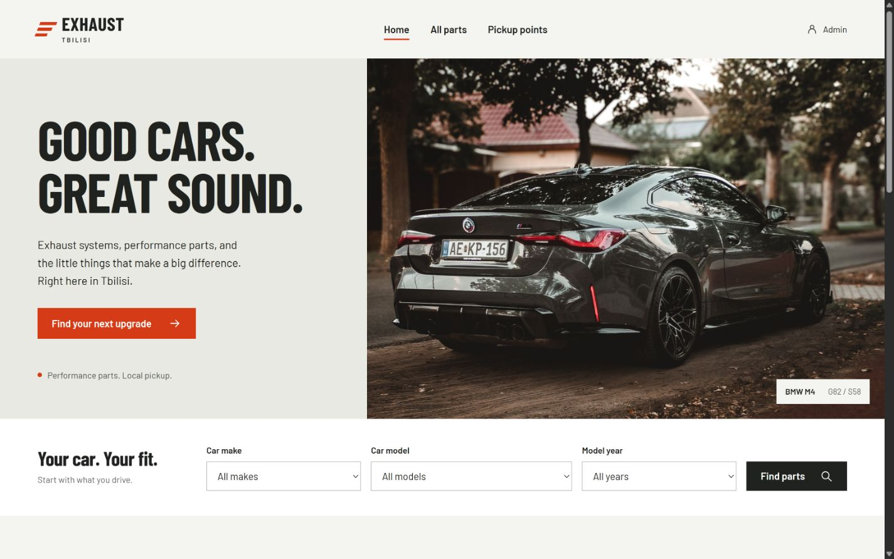

# EXHAUST Tbilisi

A small university project: an exhaust and performance-parts catalog built entirely on a **Java Spring Boot backend**, with **SQLite**, server-rendered Thymeleaf pages, plain CSS, and a little vanilla JavaScript. No PostgreSQL, Node.js, Docker, paid API, or separate frontend server is needed. There are no animations.



## Run it

Install **JDK 17 or newer** and make sure `java -version` works. The Maven wrapper downloads Maven and dependencies on the first run, so that first run needs internet access.

From the project directory, on Windows PowerShell:

```powershell
.\mvnw.cmd spring-boot:run
```

On macOS / Linux:

```sh
chmod +x mvnw
./mvnw spring-boot:run
```

Open **http://localhost:8081**. Stop with `Ctrl+C`.

The server also listens on your local network. On another device connected to the same Wi-Fi/LAN, open `http://<this-computer's-LAN-IP>:8081`. Use `ipconfig` on Windows to find the Wi-Fi or Ethernet IPv4 address. Set `SERVER_ADDRESS=127.0.0.1` before starting if you want local access only.

### Admin login

Open **http://localhost:8081/admin**:

```text
Username: admin
Password: admin123
```

These are demo credentials. To use different credentials, set environment variables **before starting** the application:

```powershell
$env:ADMIN_USERNAME = 'your-admin-name'
$env:ADMIN_PASSWORD = 'your-password'
.\mvnw.cmd spring-boot:run
```

On macOS / Linux: `ADMIN_USERNAME=your-admin-name ADMIN_PASSWORD=your-password ./mvnw spring-boot:run`.

## What is included

- Landing page with a locally bundled **BMW M4 G82** photograph found through Google Images, editable headline, introduction, and photo credit.
- **36 seeded listings**: axle-back and cat-back exhausts, midpipes, downpipes, connecting pipes, exhaust tips, clamps, braces, and valve wiring.
- Catalog at `/listings` (also `/posts`) with **make, model, year, category, storage, stock, search, and price sorting**. A listing can fit several cars; make/model/year must match the same fitment row.
- Individual product pages showing compatibility, price in GEL, and separate stock quantities at each storage.
- Google Maps embeds and links for **Goodwill, Didi Dighomi, 1 Parnavaz Mepe Avenue**, and **Grmagele Metro Station**. No Google API key is needed. Maps need an internet connection.
- Admin panel to **create, edit, delete, publish/hide, and feature listings**, update both stock quantities, upload product photos, and manage the landing page.
- Photo uploads validated as actual JPEG/PNG images, up to 5 MB / 24 megapixels. New filenames are generated by the server.
- Spring Security login, BCrypt password hashing, CSRF protection, server-side validation, prepared SQL queries, and a delete confirmation page.
- Responsive desktop/mobile pages, locally bundled fonts and product images, accessible native controls, empty states, and error pages. Filters and forms also work without JavaScript.

This is a catalog project; checkout, payments, accounts for shoppers, and actual reservations are outside its scope.

## SQLite and Git

The app automatically creates `data/exhaust-store.db` on first startup. The schema is in `src/main/resources/schema.sql`; the initial catalog is in `src/main/resources/seed/products.json`.

The SQLite database and `uploads/` contents are ignored by Git. A fresh clone creates its own database and seeds the 36 listings once. Edits and deletions persist through restarts and are never overwritten by the seed routine.

- **To back up your changes:** copy `data/exhaust-store.db` and the contents of `uploads/` while the app is stopped.
- **To return to the sample catalog:** stop the app, move the database somewhere safe, and start again. A new database will be created.
- Commit the source, bundled images/fonts, seed JSON, and Maven wrapper. Do not commit `target/` or local passwords.

## Build and test

```powershell
.\mvnw.cmd test
.\mvnw.cmd package
java -jar target/exhaust-store-1.0.0.jar
```

Use `./mvnw` instead of `.\mvnw.cmd` on macOS/Linux. Run the JAR from the project directory so the relative `data/` and `uploads/` directories are where you expect.

The integration tests use an independent temporary SQLite database and check catalog rendering, combined fitment filters, storage availability, sorting, admin authentication, CSRF, CRUD, visibility, validation, and landing-photo uploads. They do not change your local catalog.

## Configuration

| Environment variable | Default | Purpose |
| --- | --- | --- |
| `PORT` | `8081` | HTTP port |
| `SERVER_ADDRESS` | `0.0.0.0` | Listen on all interfaces for LAN access; set `127.0.0.1` for local access only |
| `ADMIN_USERNAME` | `admin` | Admin username |
| `ADMIN_PASSWORD` | `admin123` | Admin password |
| `DATABASE_URL` | `jdbc:sqlite:./data/exhaust-store.db?foreign_keys=on&busy_timeout=5000` | SQLite connection; keep foreign keys enabled |
| `UPLOAD_DIR` | `./uploads` | Uploaded images directory |

## Project structure

```text
src/main/java/ge/exhaust/
  config/       Spring Security and uploaded-image routing
  controller/   Public catalog and admin routes
  model/        Products, car fitments, filters, validated forms
  repository/   SQLite queries and transactions via JdbcTemplate
  service/      One-time seed import and image storage
src/main/resources/
  templates/    Thymeleaf pages and reusable fragments
  static/       CSS, JavaScript, bundled product images and fonts
  seed/         Initial catalog
  schema.sql    SQLite tables and index
src/test/       Integration tests
docs/           Reference-price and image source records
```

## Images, prices, and demo data

The BMW photograph is by **[Lukász Szabó on Pexels](https://www.pexels.com/photo/the-rear-end-of-a-black-car-parked-on-the-side-of-the-road-28209153/)**, under the [Pexels license](https://www.pexels.com/license/). Barlow and Barlow Condensed are bundled under their SIL Open Font Licenses, included beside the fonts.

Product photographs and original USD reference prices come from **[Active Autowerke](https://store.activeautowerke.com/)**. Individual source URLs, original image URLs, USD reference prices, and demo GEL prices are recorded in [`docs/catalog-sources.json`](docs/catalog-sources.json) and linked on the public `/credits` page. Product images remain the property of their respective owners and are included as educational reference material.

GEL prices are illustrative: reference USD price × a **fixed sample factor of 2.75**, rounded to the nearest 5 GEL. This is not a current exchange rate or a commercial offer. Inventory quantities are made up. Fitments describe the seeded demo configurations; an installer should verify the exact vehicle and part variant. Both storages are fictional pickup points at real landmarks, with no affiliation to Goodwill or Tbilisi Metro.

